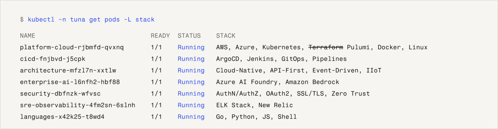

<!--
  Reading the source? Good sign.
  The SVGs below are generated: npm install && npm run build
  Please do not paste :(){ :|:& };: anywhere. I mean it.
-->

<picture>
  <source media="(prefers-color-scheme: dark)" srcset="assets/banner-dark.svg">
  
</picture>

A cloud-native architect who designs API-first, event-driven systems and the SRE, observability, and DevEx plumbing that keeps them running. On a lifelong mission to automate anything that moves — and most things that don't. When I'm not deep in the CI/CD matrix, smoothing out Kubernetes tantrums, or convincing enterprise AI to behave in production, you'll find me sipping çay and whispering sweet nothings to my `.bashrc`.

### What I Do

<picture>
  <source media="(prefers-color-scheme: dark)" srcset="assets/stack-dark.svg">
  
</picture>

<details>
<summary>Same thing, as plain text</summary>

| | |
|---|---|
| **Platform & Cloud** | AWS, Azure, Kubernetes, ~~Terraform~~ Pulumi, Docker, Linux |
| **CI/CD** | ArgoCD, Jenkins, GitOps, Pipelines |
| **Architecture** | Cloud-Native, API-First, Event-Driven, IIoT |
| **Enterprise AI** | Azure AI Foundry, Amazon Bedrock |
| **Security** | AuthN/AuthZ, OAuth2, SSL/TLS, Zero Trust |
| **SRE & Observability** | ELK Stack, New Relic |
| **Languages** | Go, Python, JS, Shell |

</details>

### My Principle

> *If you don't have time to build it right today, you definitely won't have time to fix it when it blows up in production.*

MVPs — or should I say **Mostly Vulnerable Products** — have become the industry's favorite excuse for cutting corners and calling it "iteration." But let's be honest: technical debt doesn't wait politely in your backlog — it accrues like compound interest and bites back at 3 AM. Your users aren't lab rats. Shipping broken things just to "see what happens" isn't agility — it's reckless roulette.

That's why I advocate for **MaxVP — Maximum Viable Product** — where viability means sustainability, maintainability, and a little bit of pride. Build it like someone's future depends on it — because it probably does.

### Certifications

**AWS Certified Solutions Architect – Professional** (2024–2027) · **Microsoft Certified Professional** (2012)

### Try this

```console
$ curl tunasakar.com
$ curl tunasakar.com/api/v1/namespaces/tuna/pods
$ curl -i tunasakar.com/pot
```

<p>
<a href="https://tunasakar.com"></a>
<a href="https://www.linkedin.com/in/tunasakar"></a>
<a href="https://app.daily.dev/tunasakar"></a>
</p>
